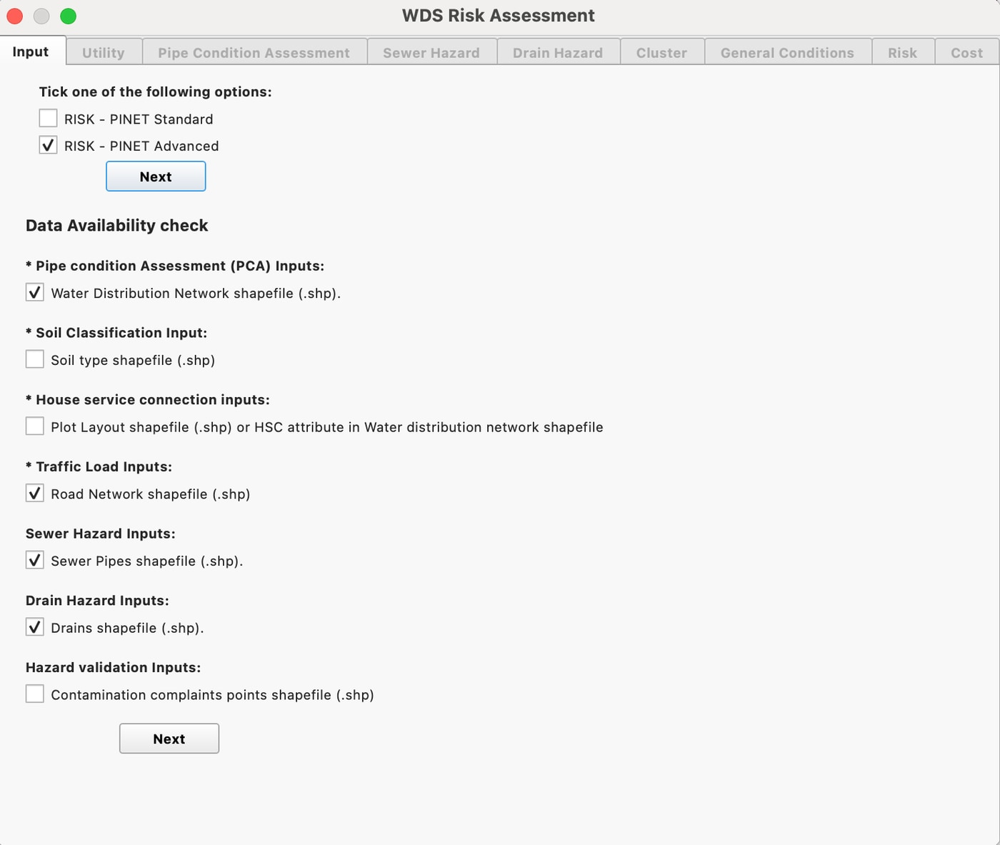

# RISK-PiNET

A GIS-based risk assessment modelling tool for water distribution systems,
developed during a Project Associate role at the National Environmental
Engineering and Research Institute (NEERI), a CSIR laboratory.

Full write-up: [vignapurohit.github.io/projects/risk-pinet](https://vignapurohit.github.io/projects/risk-pinet/)

Source code and detailed implementation materials cannot be shared due to
organisational confidentiality requirements — see the write-up for the
peer-reviewed preprint describing the methodology instead.

The QGIS application screenshot and project logo used in the write-up
live in the site's own asset folder, not duplicated here:
[`static/assets/images/risk-pinet-qgis.jpg`](../../static/assets/images/risk-pinet-qgis.jpg) and
[`static/assets/images/risk-pinet-logo.png`](../../static/assets/images/risk-pinet-logo.png).

---

This folder lives inside the [portfolio site repo](https://github.com/VignaPurohit/VignaPurohit.github.io/tree/main/code/risk-pinet) — it isn't part of the Hugo build.
