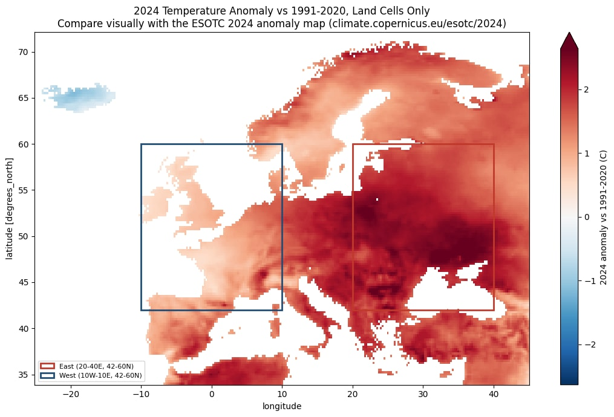

# European City Temperature Anomaly

How much warmer were Europe's large cities in 2021–2024 than the 1991–2020
WMO baseline, and how many people live in them — computed cloud-natively
from Overture Maps city locations and the Copernicus ERA5 archive, with no
local data download.

Full write-up: [vignapurohit.github.io/projects/temperature-anomaly-europe](https://vignapurohit.github.io/projects/temperature-anomaly-europe/)

## In this folder

- **[`notebooks/europe_climate_anomaly.ipynb`](notebooks/europe_climate_anomaly.ipynb)** — the full analysis, end to end

The climate analysis report, result figures, and the interactive per-city
map live in the site's own asset folder, not copied here a second time:
[`static/assets/reports/European-City-Temperature-Anomaly-Report.pdf`](../../static/assets/reports/European-City-Temperature-Anomaly-Report.pdf),
[`static/assets/images/`](../../static/assets/images/) (filenames start
`temperature-anomaly-`), and
[`static/assets/europe-temperature-anomaly-map.html`](../../static/assets/europe-temperature-anomaly-map.html).

## Pipeline

1. **Cities.** Query 330,261 Overture Maps `divisions` localities with
   population, directly from S3 GeoParquet via DuckDB — no download. Filter
   to Europe and 500,000+ population, drop non-city administrative units
   and localities swallowed by a more populous neighbour (113 cities, 30
   countries).
2. **Temperature.** Open Planette's ERA5 `t2m_max` monthly store
   (1991–2024, C3S European domain) lazily with **Icechunk** and **XArray**
   — no local download of the grid either.
3. **Anomaly.** Monthly means vs. a 1991–2020 monthly climatology, annual
   anomaly as the equal-weighted mean of the 12 monthly anomalies (WMO/C3S
   convention). One vectorised nearest-grid-cell selection extracts every
   city's value — no per-city loop.
4. **Exposure.** Population-weighted anomaly ranks which cities combine a
   large temperature departure with a large population.
5. **Validation.** Compared against Copernicus ESOTC 2024 and the Turkish
   State Meteorological Service's published 2024 land anomalies, plus a
   sanity check against WMO 1991–2020 station normals for five cities.
6. **Map.** An interactive Folium map per city — colour for anomaly
   magnitude, size for population, a red border for the top 20% national
   anomaly percentile, popup with the full detail.

## Key results

- **113 cities, 30 countries, 172M people** — mean anomaly **+1.0°C**
- 62 cities (78.7M people) at or above +1.0°C
- Range: **+0.3°C** (Oslo) to **+1.6°C** (Bucharest) — no city reaches +2.0°C
- East–west contrast in 2024: eastern Europe (20–40°E, 42–60°N) averaged
  **+2.1°C** over land vs **+1.0°C** in the west (10°W–10°E, 42–60°N)
- Validated against Copernicus ESOTC 2024 (+1.6°C vs published +1.47°C)
  and the Turkish State Met. Service (+1.7°C vs published +1.70°C), both
  within ±0.3°C

## Tools

DuckDB (S3 GeoParquet), Icechunk + XArray + Dask (cloud-native NetCDF/Zarr
access), GeoPandas, Folium (interactive map), Matplotlib, Seaborn.

## Data sources

Overture Maps Foundation (`divisions` theme), Planette ERA5 Archive (based
on Copernicus ERA5), WMO 1991–2020 Climate Normals, Copernicus/WMO European
State of the Climate 2024, Turkish State Meteorological Service.

---

This folder lives inside the [portfolio site repo](https://github.com/VignaPurohit/VignaPurohit.github.io/tree/main/code/temperature-anomaly-europe) — it isn't part of the Hugo build.
